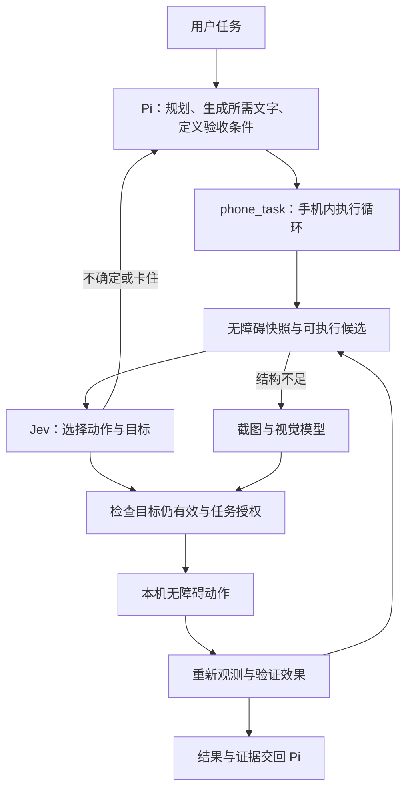

# Zfold Android 自动化方案

评估日期：2026-09-28。本文保留初版设计；0.2.13 的 Jev 接入状态、实现范围与验证方法见 [JEV_INTEGRATION.md](JEV_INTEGRATION.md)，实际验收结果见 [VERIFICATION.md](VERIFICATION.md)。

## 结论

优先参考用户指定的 [droidrun/mobile-jev](https://github.com/droidrun/mobile-jev)，在现有 APK 内实现「Pi 规划任务 → 手机执行循环 → 回传证据」。保留现有 Java 无障碍服务与 Node/Pi，Jev 作为可替换的动作选择器。视觉模型处理无障碍树缺失、图标语义不明等场景。

这保留了当前产品的目标：用户只需安装 APK、开启所需权限和配置模型，运行时无需电脑、ADB、Termux 或云手机。模型推理仍可联网；手机本地运行不等于模型离线。

MCP 负责对外提供统一工具接口。APK 内已有 Pi 自定义工具和 JNI 管道，第一阶段直接注册 `phone_task` 即可；如果以后需要电脑端代理控制手机，再给同一执行器增加经过认证的 MCP 接口。

## 上游项目的适用范围

| 项目 | 现有运行方式 | 对本项目的用途 |
| --- | --- | --- |
| [mobile-jev](https://github.com/droidrun/mobile-jev) | Node 控制循环，通过 Mobilerun API 操作设备，另有 Studio/CLI | 首选参考；动作和目标的联合选择、候选验证、状态复查、输入校验、执行记录 |
| [Mobilerun Framework](https://github.com/droidrun/mobilerun) / [Portal](https://github.com/droidrun/mobilerun-portal) | 本机 Python 控制器和手机 Portal；另有云服务 | 参考成熟的界面采集和操作能力；若允许电脑常驻，可直接评估框架 |
| [jev-android](https://github.com/dougsong/jev-android) | Kotlin SDK 与 Android 无障碍执行循环 | 参考本机运行、取消和动作事件；API 尚不稳定，未发布 Maven Central |
| [jevdevice](https://github.com/Xopher00/jevdevice) | Python/ADB/MCP | 外部代理控制真机的参考，直接装进现有 APK 不合适 |

源码核对：`mobile-jev` commit `395fc222beac4f059f9a0beb337d114a2b066e99`，调研副本位于 `.build/research/mobile-jev`，未作为应用依赖打包。

具体可参考的源码：

- [`policy.mjs`](https://github.com/droidrun/mobile-jev/blob/395fc222beac4f059f9a0beb337d114a2b066e99/scripts/mobile-agent/policy.mjs)：一次请求中询问 operation 和各类候选目标，只消费被选动作对应的目标答案；校验概率分布。默认置信度阈值为 0，不能把它当作开箱即用的可靠性保证。
- [`device.mjs`](https://github.com/droidrun/mobile-jev/blob/395fc222beac4f059f9a0beb337d114a2b066e99/scripts/mobile-agent/device.mjs)：执行前校验应用、屏幕尺寸、观测时间及目标语义。
- [`agent.mjs`](https://github.com/droidrun/mobile-jev/blob/395fc222beac4f059f9a0beb337d114a2b066e99/scripts/mobile-agent/agent.mjs)：观测、决定、执行和复查；限制重复动作、等待和页面失效；先记录已执行动作再读新页面。
- [`input-verification.mjs`](https://github.com/droidrun/mobile-jev/blob/395fc222beac4f059f9a0beb337d114a2b066e99/scripts/mobile-agent/input-verification.mjs)：回读输入框的完整值。
- [`http.mjs`](https://github.com/droidrun/mobile-jev/blob/395fc222beac4f059f9a0beb337d114a2b066e99/scripts/mobile-agent/http.mjs)：Jev 用复用连接的 HTTPS；Mobilerun 使用外部 curl 子进程。后者应替换为本机 JNI 适配器。

上游通用循环中的 `DONE` 是模型判断；独立任务验证由具体 demo 等调用层提供。中文输入、Fold7 切屏、真实常用 App 的效果仍需本机验收。本文不把上游演示耗时作为本项目性能。

## 当前代码的实际缺口

- `ui_select` 使用文字归一化和唯一匹配，没有 Jev 或语义选择。适合明确标签的直接操作，对多步目标、同名按钮和页面探索有限。
- `PhoneAccessibility.walk()` 当前提供文字、描述、类名、包名、可点击、可编辑和坐标。缺少 `enabled`、`checked`、`selected`、`focused`、`scrollable`、`resourceId`、动作列表等关键状态。
- 节点缓存会被窗口内容变化全部清除。应区分目标应用、输入法与助手覆盖层，并按动作检查目标语义；不能因助手自己的进度更新而让目标失效，也不能忽略真实页面变化。
- `ACTION_CLICK` 失败后当前会尝试节点中心坐标。后续应先重新确认目标、窗口与几何关系，记录执行状态，避免把未知结果当作未执行而重试。
- `ui_input` 只报告系统是否接受设置文本；尚未回读完整值，也不能证明目标应用已保存。
- `ui_select.verified` 目前仅表示重新获得了屏幕，不代表用户目标达成。后续需要独立的 `observed`、`actionAccepted` 和 `outcomeVerified` 字段。
- 原有工具 UI 仅显示临时状态；0.2.12 补充工具名称、参数、返回内容、失败/停止状态、展开详情和历史恢复。它展示执行证据，不把「工具已返回」等同于「任务已成功」。

## 推荐的执行结构

### 1. 观测层

统一返回 `snapshotId`、观测时间、前台包名、窗口/显示尺寸、输入法状态、语义节点及实际支持的动作。节点 ID 绑定该次快照。补全可用、选中、勾选、焦点、滚动、密码字段、资源 ID 和操作能力。

把子节点的可见标题合入可点击容器的候选描述；按窗口、可见区域和语义分组限制候选数量。等待页面稳定使用事件和有上限的复查，避免每次动作固定长时间休眠。保留滚动区域，不让模型猜全屏滑动坐标。

### 2. 决策层

Pi 给出当前子目标、准确的候选输入文本、预期页面/状态和允许操作的应用。Jev 在可执行候选内选 `OPEN_APP / TAP / INPUT / SCROLL / BACK / WAIT / DONE / BLOCKED`，动作与目标尽量同次请求，允许明确弃权。

决策接口可替换：Jev 与当前 OpenAI 兼容模型使用相同的候选/结果契约，便于真机对比。置信度阈值、前两项差距、循环检测和最大步数需通过本机任务校准。不能只依据一个高置信度数字执行。

Jev 配置独立于聊天模型，不复用不兼容的 API Key。准备发送给所选模型的界面数据只包括任务所需内容，明确标记为外部数据，不能当作新增指令。

### 3. 执行与恢复层

优先调用节点声明支持的 Android 动作。输入后回读完整字段，打开应用后确认前台窗口，点击开关后检查 `checked`；返回新屏幕本身不能证明目标完成。

动作前重新确认目标所属应用、支持动作、语义与必要几何关系；失效时重新观测。执行结果不明确时先查状态，避免重复点击、重复输入或重复提交。

每步记录 `planned → dispatched → observed → verified/failed/unknown`。整个任务只有满足明确验收条件才返回 `verified`；其他结果使用 `unverified`、`blocked`、`cancelled`。保存轨迹便于重新打开 UI、诊断与恢复，恢复后先观察当前手机，不能重播未知动作。

停止通过同一个取消信号中断模型请求、等待和后续动作；已经提交 Android 的手势可能完成，状态中说明这一点。执行器按设备串行，避免两个会话同时控制手机。

### 4. 视觉后备

无障碍树不可用或不足时，由支持视觉的模型解释截图。截图坐标必须绑定截图 ID、时间、显示尺寸和旋转状态，执行前复查，避免旧图坐标误点。受保护页面读不到时返回限制，不虚构内容。已有 `screen_capture` 和模型图片输入可作为起点。

### 5. 面向 Pi 与 UI 的接口

建议新增 `phone_task({goal, allowedPackages, textValues, expectedOutcome, maxSteps})`。每一步通过工具更新事件返回：动作描述、候选目标、所用模型、耗时、当前状态与观测结果。完成返回结构化证据。

UI 默认展示可读的动作记录，展开后看参数、结果和失败原因；主界面、系统助手、独立悬浮窗保持一致。MCP 若以后需要，包装同一执行器提供 `start_task/get_task/cancel_task`，无需维护两套手机逻辑。

## 实施次序与验收

1. **工具可见性**：0.2.12 先修复实时状态、返回内容与历史恢复，建立可观察的基础。
2. **可靠执行基础**：扩充无障碍快照，补全状态验证与目标新鲜度检查，用确定性本机测试页面验证；这一阶段先不改变默认决策模型。
3. **可替换决策器**：接 Jev 的独立配置和 `phone_task`，对比当前模型。固定同一任务、起始状态、设备、语言和模型版本，保留全部成功/失败轨迹。
4. **视觉与恢复**：覆盖无障碍信息不完整的应用，补充截图校验、任务日志和受控恢复。

首批用本机测试页和可恢复设置场景：同名目标、开关已开启、列表滚动、中文输入及回读、页面在决定后变化、输入法遮挡、助手收起重开、折叠旋转、网络超时、随时停止。再逐步扩展到真实 App 的搜索、表单草稿等场景。

记录完整任务成功率、误操作次数、未知结果次数、模型请求数、单步及总耗时的中位数/p95、停止到最后一次新动作的延迟。通过率和延迟尚无本机数据，应由实测决定默认选择器。

## 初版设计时的交付边界（0.2.12）

已实施工具显示修复；自动化部分完成源码调研与设计。没有调用 TypeSafe/Mobilerun 服务、配置新密钥、安装 Portal、接入 Jev 或宣称已验证 Jev 的真机效果。若后续直接复用 MIT 源码，需固定版本并保留版权和许可证。

随后用户提供 `JEV_API_KEY`，0.2.13 已实现直接 TypeSafe 接入，并在隔离 Android 模拟器上完成真实 Jev 的测试页开关/中文输入闭环。实现和本轮边界见 `JEV_INTEGRATION.md`；0.2.14 已在 Fold7 上通过同一专用测试页及工具 UI 验收；常用第三方 App 的任务能力仍待验证。
